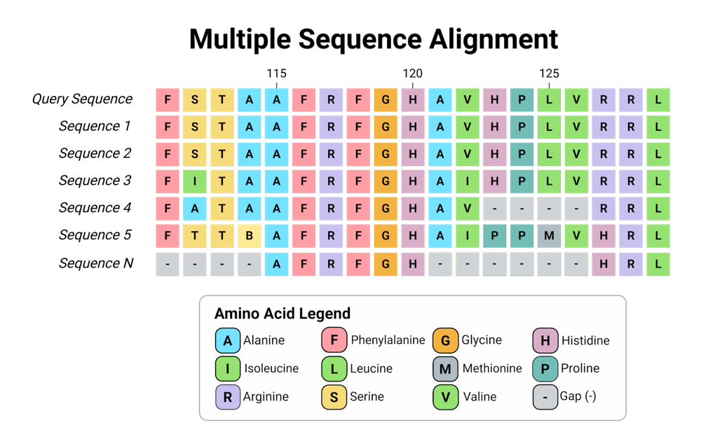
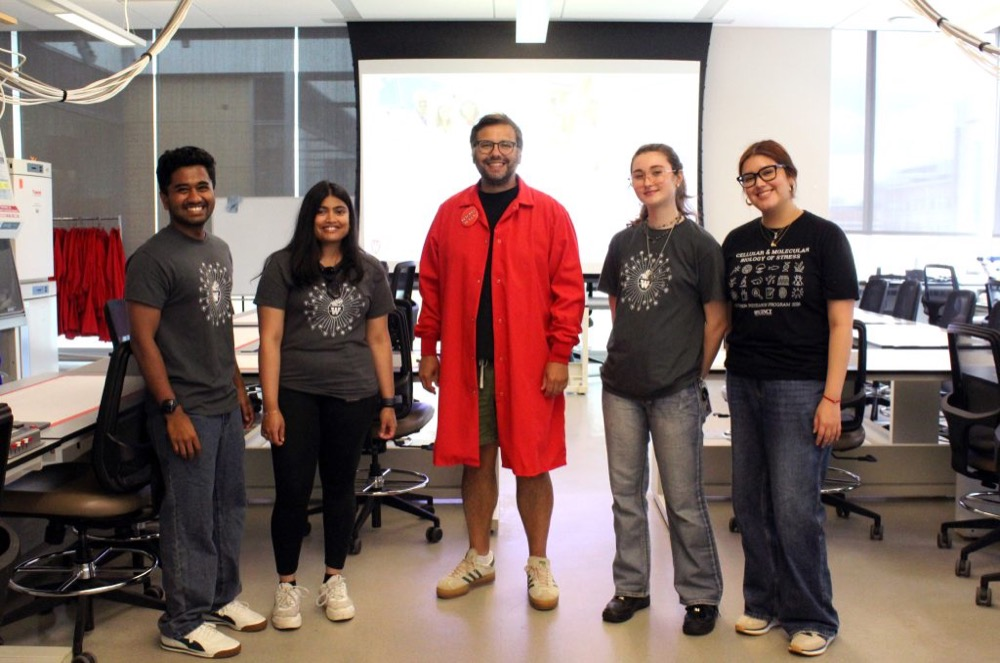
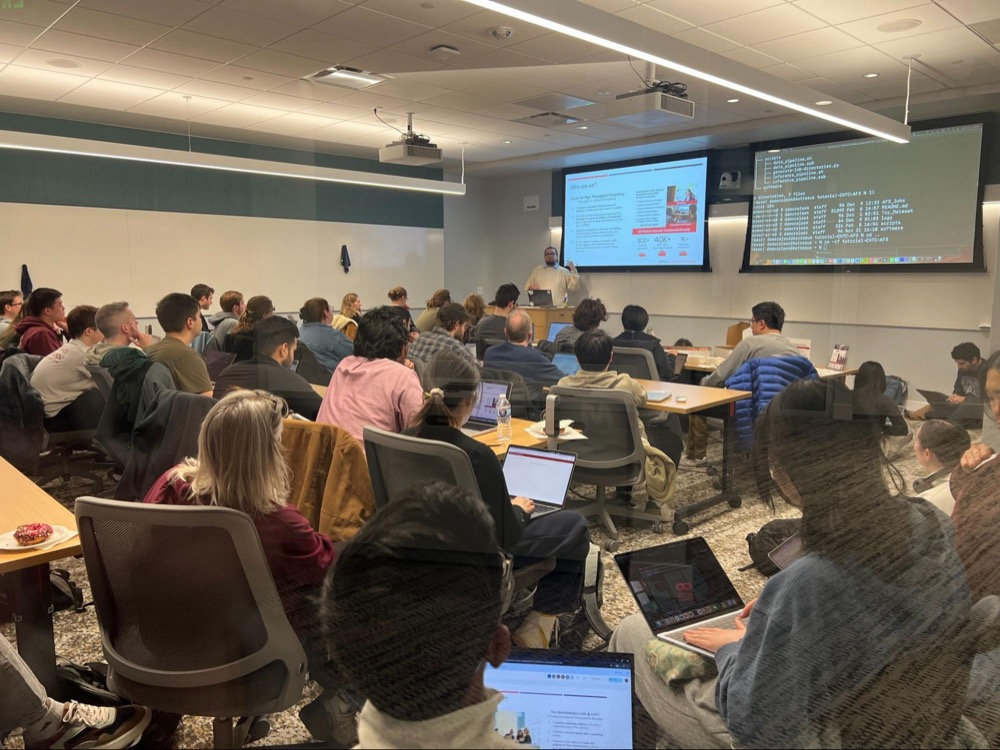
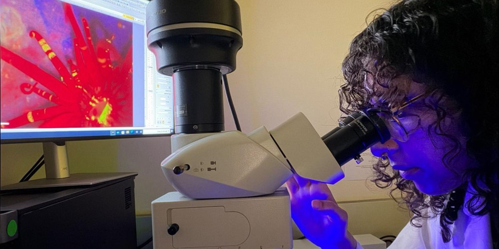

The biggest challenge facing researchers using AI-based protein predictors such as AlphaFold3 is running it at scale. In 2024 the AlphaFold team won the Nobel Prize in Chemistry recognizing advances in protein structure prediction and computational protein design. Following this award, AlphaFold3, an AI protein prediction software, became highly in demand by researchers.

AlphaFold3 searches researchers’ input amino acid sequences against biological databases to build the evolutionary context of how the protein evolved over time. This evolutionary context (called alignments) is used to predict the 3D structure of a biomolecule or complex, helping researchers investigate the molecular interactions, interpret biological function, and guide experiments in drug discovery. However, computing these alignments requires long time input preparation steps and searching through large reference databases (around 650 gigabytes in size) before any structure prediction can begin. This leads to long runtimes and scheduling challenges on distributed high-throughput computing systems. Finding machines that can transfer and hold that much data is one of the most expensive parts of running AlphaFold3.

Shared resources via the [OSPool](https://osg-htc.org/services/ospool/) and the [Center for High Throughput Computing (CHTC)](https://chtc.cs.wisc.edu/) help researchers overcome those limitations in several ways. One is a shared library of pre-computed alignments. Before AlphaFold3 can predict a protein’s shape, it must build an alignment. An alignment lines up the same protein from many species, letter by letter, highlighting conserved or variable regions across similar sequences. Building an alignment means searching large protein databases, which takes 30 minutes to an hour of computing time for each protein. When many researchers study the same proteins, the same alignment is produced over and over. The OSPool [AlphaFold3 Alignment Library](https://osg-htc.org/services/osdf/alphafold/) lets researchers skip that step when the work has already been done.

<figure>

<figcaption>Example of a Multiple Sequence Alignment. Created in BioRender. Morales, D. (2026) <a href="https://BioRender.com/54c67wp">https://BioRender.com/54c67wp</a></figcaption>
</figure>

<figure style="float: right; margin: 0 0 1rem 1rem; width: 250px;">

<figcaption>Pictured: CHTC Facilitator Daniel Morales. Credits: Daniel Morales</figcaption>
</figure>

The idea for the library came from CHTC Research Computing Facilitator Danny Morales and CHTC Director Miron Livny as part of the [Fabric for AI-Driven Science (FabAID)](https://fabaid.io/) project. The goal behind the library is to make alignment artifact reuse easier and reproducible for science, and the project is focusing on the findable and reusable parts of that framework. Using AlphaFold3 can be computationally intensive and expensive. Generating a single alignment takes between half an hour and one hour of CPU time, so every alignment that can be shared instead of recomputed saves that time for the next researcher. The AlphaFold3 Library makes alignments easy to find and reuse, and is accessible to any user of the OSPool, holding more than 1.4 million alignments covering over 25,000 species, including 84,267 contributed by the OSPool/CHTC research community. To date, researchers have submitted nearly 2.3 million queries, and more than 690,000 of them were answered with an alignment already in the library.

One group using the library are the researchers in the [Mehta Lab](https://mehtalab.vetmed.wisc.edu/) at the University of Wisconsin-Madison, who are exploring how viruses cause lesions to their host’s DNA, often resulting in cancer via interactions with the human proteome. The human body encodes roughly 20,000 proteins. To find out which of them interact with the human papillomavirus (HPV), the Mehta Lab is using AlphaFold3 to pair each human protein with each of nine HPV proteins they are studying. This results in a classical N x M combinatorial explosion, requiring approximately 180,000 protein-protein interaction predictions per HPV. Each human-HPV combination would take 50 to 60 days of computing time, if every alignment had to be built from scratch. With over 200 types of HPVs, these analyses become unfeasible.

<figure>

<figcaption>Pictured: The Mehta Lab, University of Wisconsin-Madison. Credits: Cristhian Salas Quinchucua, Spurgeon Lab</figcaption>
</figure>

By drawing on the OSPool Alignment Library where the human proteins had already been aligned, the lab cut that to about 5 days, a savings of roughly 90% compute hours. Dr. Kavi Mehta, Mehta Lab Principal Investigator and Assistant Professor in the department of Comparative Biosciences in the School of Veterinary Medicine, noted “We are leveraging CHTC resources to solve the human proteome and HPV proteome interaction network with AlphaFold. We are predicting interactions between PV proteins and using our findings to apply them at the bench and as a resource to the field at large.”

The library holds alignments from several sources: alignments generated on the OSPool, alignments released by Google DeepMind, and alignments contributed by other researchers. When a researcher submits a protein sequence, the job first converts the sequence to a hash unique to that sequence. It then uses the code snippet to check whether the library already holds an alignment for that sequence. The researcher decides which sources to accept. If there's a match, the job fetches the alignment in seconds via [Pelican](https://pelicanplatform.org/), software designed to facilitate data distribution on the [OSDF](https://portal.osg-htc.org/documentation/htc_workloads/managing_data/osdf/), and passes it to AlphaFold3, allowing the job to jump straight to predicting the structure. Any newly computed alignments are published to the library, so the next job doesn’t have to repeat the work.

CHTC is also improving workflows and boosting efficiency before researchers even begin running their jobs. Facilitators have run over 1.3 million AlphaFold3 jobs themselves to contribute to the AlphaFold Alignment Library, and used that experience to improve the workflow.

<figure>

<figcaption>Pictured: February AlphaFold3 Training hosted at CHTC. Credits: Rachel Lombardi</figcaption>
</figure>

The improved workflow also separates the AlphaFold3 job into two distinct stages: A CPU-only data-intensive alignment-generation step, and a GPU-dependent model inferencing step. This separation maximizes resource utilization by preventing limited resources, such as GPU capacity, from sitting idly during alignment generation. Separating these two stages in the workflow results in an approximately 32% reduction in compute cost by eliminating wasted GPU-hours. Furthermore, the facilitator-supported AlphaFold3 workflow embeds smart GPU memory selection, allowing researchers to run on larger swaths of the pools’ GPU capacity based on their individual prediction’s requirements. This was achieved through the benchmarking of AlphaFold3’s GPU memory utilization and development of a predictive measurement for the minimum GPU memory required for each inferencing run. This work was presented at the 2026 Practice and Experience in Advanced Research Computing (PEARC) conference and received a [Best Short Paper award](https://dl.acm.org/doi/10.1145/3785462.3815874).

In addition to shared workflows and the AlphaFold library, the AlphaFold3 workflows are able to run much faster as a result of the caching built into the [Pelican Platform](https://pelicanplatform.org/) and [Open Science Data Federation (OSDF)](https://osg-htc.org/services/osdf). Alignments moving back and forth through the OSDF are cached, and after a user searches through the library and finds some matches, the user job will fetch the alignment using Pelican. These alignments are stored temporarily at locations across the country, nearby the compute resources, so a job will usually receive its alignment from a cache rather than from the original storage site, leading to a shorter download time. As a result of making the library’s alignments available through the OSDF, saved alignments can be delivered more efficiently to any workflow that uses the library.

<figure>

<figcaption>Pictured: Hannan Shabaan from Florida International University studying Exaiptasia diaphana, a species of sea anemone and a key scientific model organism for coral symbiosis research. Credits: Hannan Shabaan</figcaption>
</figure>

Many research questions require thousands of predictions, exceeding researchers’ local computing capacity. The OSPool and CHTC provide the computing resources needed to pursue these questions at scale. For researcher Hannan Shabaan, from the [Pienaar Lab](https://jpienaar.wixsite.com/my-site) at Florida International University (FIU), these OSPool services have provided the compute capabilities needed to advance her research exploring sea anemone symbiont bleaching mechanisms. By leveraging the Alignment Library service, Shabaan was able to reduce the compute need from 1 billion core hours down to 65,000. The facilitation team is also working to make AlphaFold more accessible to a wider scope of researchers, Dr. Mehta noted that “Much of this [our] work has been performed by a talented high school student through mentor guidance and using the CHTC tutorials.” Using CHTC provided resources and training, users can boost their ability to use AlphaFold in their research without prior computing or experience with the software.

The work to support AlphaFold3 researchers is still growing. The alignment library began as a prototype hosted on [Jetstream2](https://jetstream-cloud.org/index.html) at Indiana University, and is now moving toward a service operated by CHTC. At the same time, CHTC is expanding how researchers can scale their work. The new self-service annex, a way for researchers to add their own computing allocations to CHTC’s system, lets researchers run AlphaFold3 across CHTC, the OSPool, and [ACCESS](https://access-ci.org/)/[NAIRR](https://nairrpilot.org/) allocations. Looking ahead, the team is exploring support for other protein structure models, including [OpenFold](https://openfold.io/), [RoseTTAFold](https://www.science.org/doi/10.1126/science.abj8754), and ESMFold, and exploring uses of the library beyond structure prediction, such as general evolutionary analysis.

If you are an OSPool user interested in learning more about how to run AlphaFold3 workflows on OSPool resources, the Research Computing Facilitation team will be hosting a hands-on tutorial introducing researchers to running [AlphaFold3 at large scale on the OSPool](https://osg-htc.org/events/2026/12/15/Alphafold3/) on December 15th, from 2:30-4:00 pm EST. Participants will learn how to prepare AlphaFold3 inputs, separate the workflow into CPU-based alignment generation and GPU-accelerated structure prediction, submit and manage jobs with HTCondor, and use containers and distributed data resources to build scalable and reproducible protein structure prediction workflows. Participants will also learn about the OSPool AlphaFold MSA Library, a service aimed at reducing researchers’ time-to-results by caching and reusing alignments across different jobs. 

Register for this upcoming training on the [OSG event page](https://osg-htc.org/events/2026/12/15/Alphafold3/).

